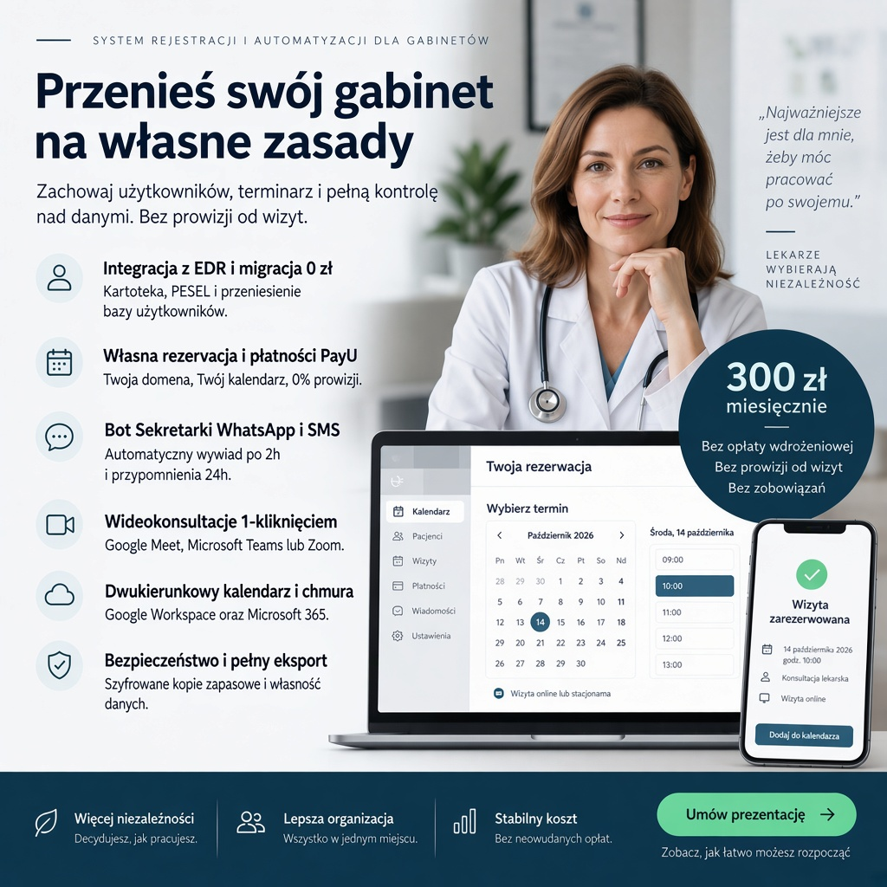

# HejDok — System Rejestracji i Automatyzacji dla Gabinetów Lekarskich



Kompletny system rezerwacji wizyt online, komunikacji z pacjentem i automatyzacji pracy gabinetu lekarskiego (**0% prowizji od wizyt**, pełna własność bazy pacjentów i możliwość działania na standardowym hostingu PHP/MySQL, np. `home.pl`).

---

## Najważniejsze możliwości systemu

- **Integracja z EDR / EDM i migracja bazy (`0 zł`)** — przygotowanie pod spięcie z systemem gabinetowym (kartoteka pacjenta, weryfikacja PESEL, e-recepta, e-ZLA, e-skierowania) oraz bezpłatne przeniesienie dotychczasowych pacjentów i terminów.
- **Własna rezerwacja online na domenie gabinetu** — przejrzysty, minimalistyczny proces zapisu dla pacjenta (wybór rodzaju wizyty, dnia i konkretnej godziny, zarządzanie wizytą przez bezpieczny link tokenowy).
- **Płatności online PayU (`0% prowizji po stronie systemu`)** — przekierowanie do płatności po rezerwacji, weryfikacja podpisu `OpenPayu-Signature` i automatyczne potwierdzenie wizyty po statusie `COMPLETED`.
- **Bot Sekretarki WhatsApp (auto-odpowiedź po 2h)** — gdy lekarz nie może odpisać, bot analizuje ostatnie wiadomości pacjenta, rozpoznaje kategorię sprawy (`termin`, `recepta/leki`, `zaświadczenie`, `płatność`, `pilne`), nadaje etykiety wątkom i zbiera dane (imię i nazwisko, PESEL, adres, opis sprawy) w formie zaszyfrowanej (`AES-256-GCM`).
- **Automatyczne przypomnienia SMSAPI i e-mail** — przypomnienia 24h przed wizytą z linkiem do potwierdzenia lub odwołania terminu, szablony wiadomości oraz ręczna wysyłka SMS jednym kliknięciem z panelu.
- **Wideokonsultacje (Google Meet, Microsoft Teams, Zoom)** — automatyczne generowanie indywidualnego pokoju wideo z poczekalnią (`meeting_url`) i wysyłka linku pacjentowi.
- **Synchronizacja z Google Workspace i Microsoft 365** — dwukierunkowy kalendarz (Google Calendar / Outlook Calendar), rozpoznawanie numerów telefonów pacjentów (Google Contacts / Microsoft People), poczta gabinetowa i zewnętrzne kopie zapasowe (Google Drive / OneDrive).
- **Bezpieczeństwo i pełny eksport danych w każdej chwili** — automatyczne kopie zapasowe rezerwacji co 6 godzin, szyfrowanie wrażliwych metadanych i pełna kontrola nad bazą.

---

## Drabinka integracji gabinetu


| Poziom | Integracje | Co może robić | Co zyskuje gabinet |
| :--- | :--- | :--- | :--- |
| **1. Rdzeń medyczny i rezerwacyjny** | **System EDR / EDM** (np. Gabinet.gov.pl, MyDr, ZnanyLekarz EDM, DrEryk) + **Rezerwacje i PayU** | • Wyszukuje lub zakłada kartę pacjenta po numerze PESEL<br>• Przenosi wywiad zebrany przez bota WhatsApp do roboczej notatki wizyty<br>• Obsługuje e-recepty, e-ZLA, e-skierowania oraz grafik online<br>• Po statusie `COMPLETED` z PayU automatycznie oznacza wizytę jako opłaconą i potwierdzoną | Brak ręcznego przepisywania PESEL-u, adresu i powodu wizyty między telefonem a programem lekarskim oraz brak nieopłaconych blokad w grafiku |
| **2. Komunikacja z pacjentem i wideo-wizyty** | **WhatsApp Cloud API + Bot 2h**, **SMSAPI**, **Google Meet**, **Microsoft Teams**, **Zoom** | • Po 2h braku odpowiedzi bot czyta ostatnie wiadomości pacjenta, rozpoznaje sprawę, nadaje etykiety (`termin`, `recepta/leki`, `zaświadczenie`, `pilne`) i zbiera PESEL, adres oraz opis<br>• Wysyła przypomnienia SMS dzień przed wizytą z linkiem do odwołania/potwierdzenia oraz ręczne SMS-y z szablonów<br>• Tworzy indywidualny pokój wideo z poczekalnią (`meeting_url`) i wysyła link pacjentowi | Pacjent od razu dostaje odpowiedź i link do rozmowy wideo, a lekarz ma w panelu gotowy, uporządkowany pakiet informacji |
| **3A. Ekosystem Google (Workspace)** | **Google Calendar**, **Gmail**, **Google Contacts**, **Google Drive / Docs** | • Dwukierunkowa synchronizacja grafiku wizyt i prywatnych blokad („Urlop”, „Szkolenie”)<br>• Wysyłka potwierdzeń i porannych raportów wizyt z własnej domeny<br>• Identyfikacja pacjenta po numerze telefonu (rozmowy i WhatsApp)<br>• Zewnętrzny backup rezerwacji i archiwum plików od pacjentów | Jeden kalendarz w telefonie, widoczne nazwisko pacjenta przy połączeniu i kopia danych poza serwerem |
| **3B. Ekosystem Microsoft (Microsoft 365)** | **Outlook Calendar**, **Exchange / Outlook Mail**, **Microsoft People**, **OneDrive / SharePoint** | • Dwukierunkowa synchronizacja terminów wizyt i urlopów przez Microsoft Graph<br>• Obsługa poczty gabinetowej i książki adresowej pacjentów<br>• Archiwum wzorów zaświadczeń Word (`.docx`), dokumentów pacjenta i kopii zapasowych | Pełna integracja z środowiskiem Windows 11, Outlookiem, Wordem i spotkaniami Microsoft Teams |

---

## Rozwój lokalnie (Preview / Mock Mode)

1. Sklonuj repozytorium.
2. Zainstaluj zależności:
   ```bash
   npm install
   ```
3. Domyślny tryb `VITE_API_MODE=mock` symuluje pełny przepływ rezerwacji, panelu admina, wiadomości i płatności w przeglądarce bez potrzeby uruchamiania PHP/MySQL.
4. Uruchom serwer deweloperski:
   ```bash
   npm run dev
   ```

## Budowanie i wdrożenie produkcyjne (`home.pl`)

1. Zbuduj aplikację produkcyjną:
   ```bash
   npm run build
   ```
2. Wgraj zawartość katalogu `dist/` oraz backend `deploy-homepl/` na serwer zgodnie z instrukcją w [`deploy-homepl/README_HOMEPL.md`](deploy-homepl/README_HOMEPL.md).
3. Skopiuj `deploy-homepl/config/config.example.php` do `rezerwacja/config/config.php` na serwerze i uzupełnij dane bazy MySQL oraz wybrane integracje (WhatsApp Cloud API, SMSAPI, PayU).
4. Szczegółowy opis architektury znajduje się w pliku [`ARCHITECTURE.md`](ARCHITECTURE.md).
